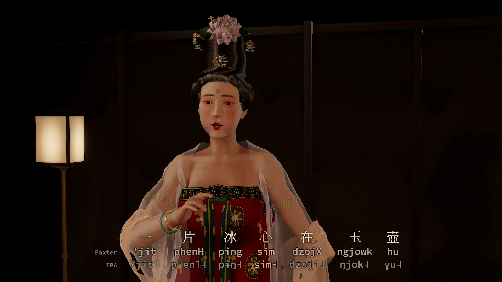
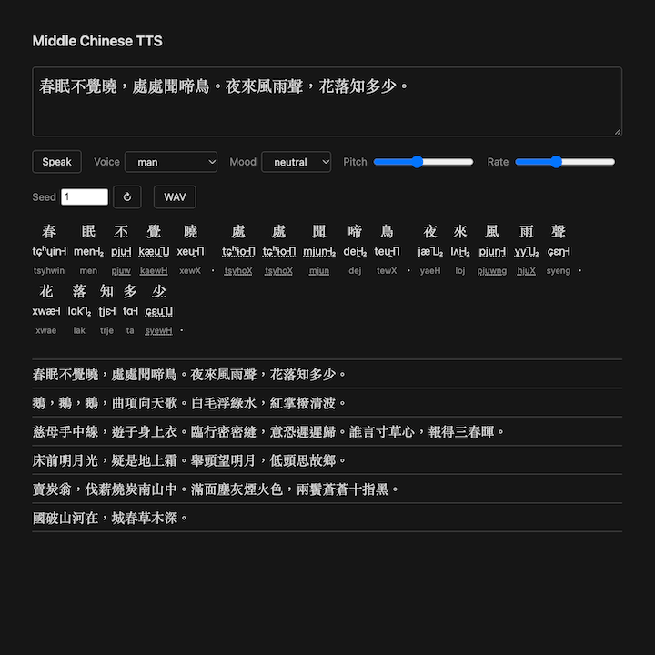
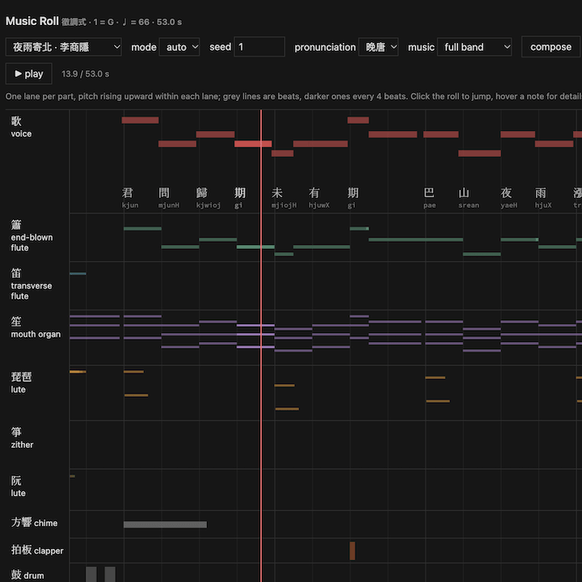
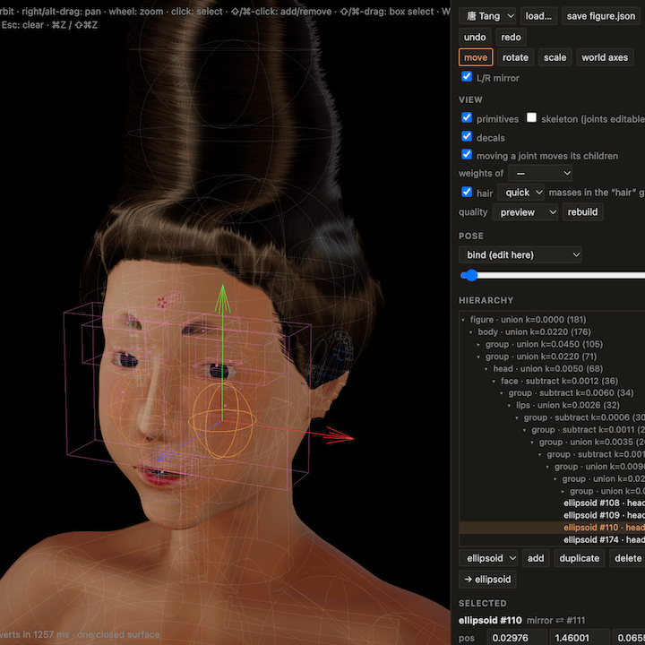
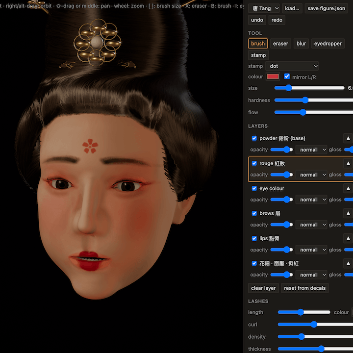
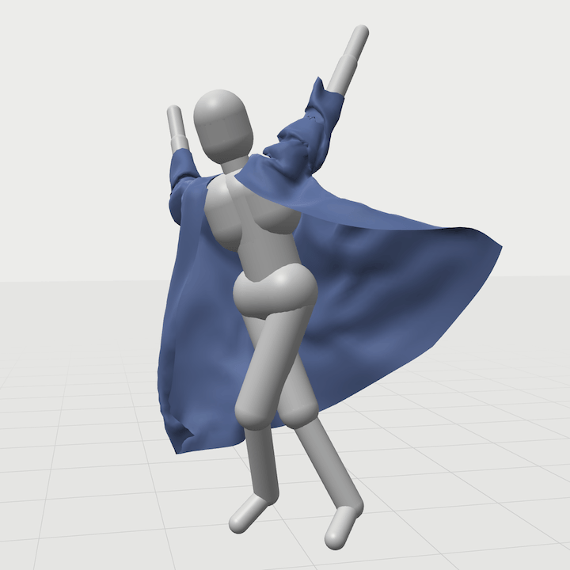
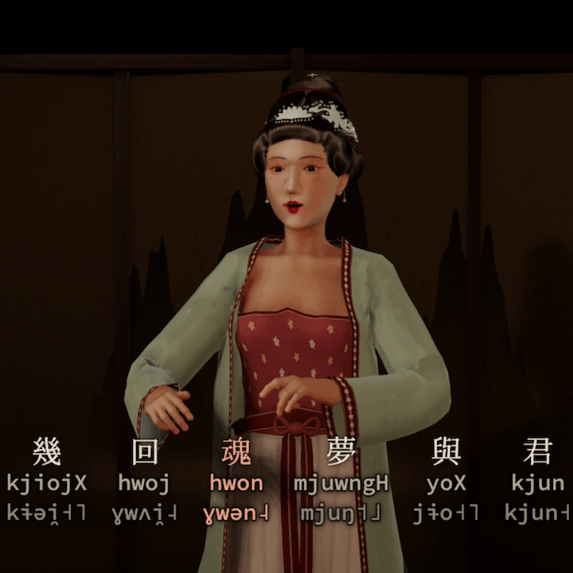

# middle-chinese-sing

### [[explainer video](https://www.instagram.com/lingd.ng/reel/DfqkMXCNV6W/) | [online demo](https://mchsing.netlify.app)]

唐詩宋詞擬音歌唱三維場景

3D reconstruction of singing in Middle Chinese.

Pipeline:

- Middle Chinese text to speech (Baxter to IPA, Klatt-style formant synthesizer)
- Procedurally generated music (based on analysis of 白石道人歌曲)
- WebGL scene of song performance (SDF-modeling, XPBD cloth simulation, generative dance moves)

|   |   |
|---|---|
|  |  |
| TTS  | music composition |
|  |  |
| SDF modeling | makeup simulator |
|  |  |
| XPBD cloth | Tang/Song stage |

Mostly vibe-coded, so don't look too hard inside!